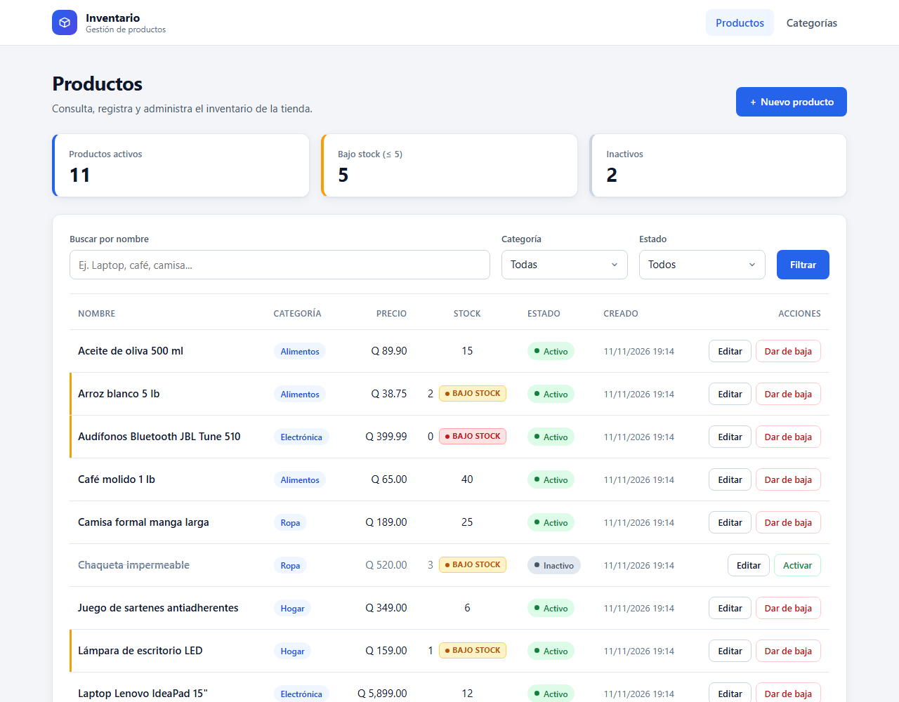
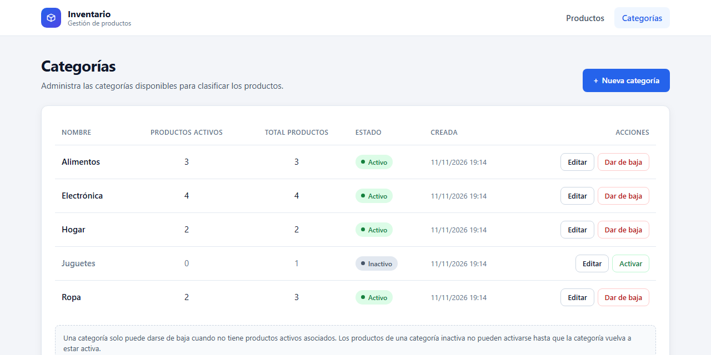
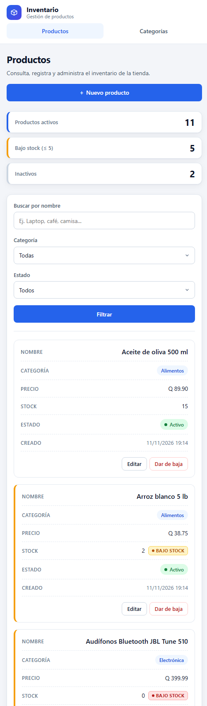
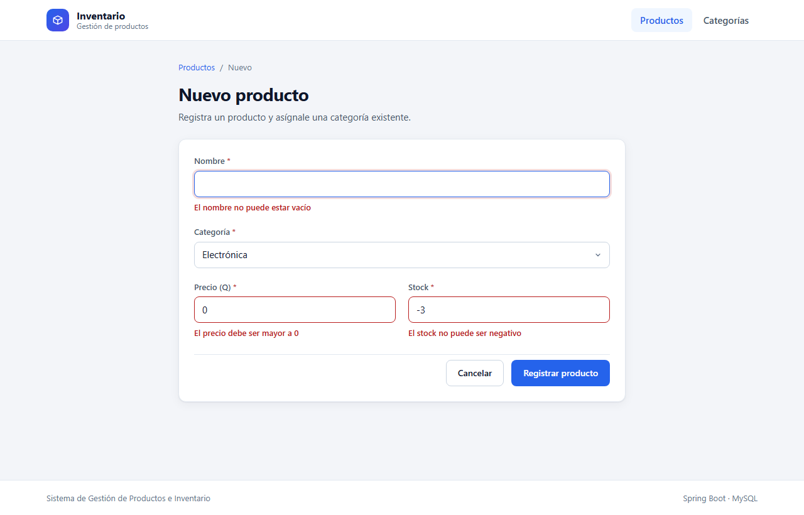

# Sistema de Gestión de Productos e Inventario (versión Docker)

[](https://github.com/brendaOviedo/Products_Docker/actions/workflows/docker.yml)

Aplicación web para el control de inventario de una tienda, desarrollada con **Java 17 + Spring Boot 3 + MySQL 8** y vistas **Thymeleaf** con **CSS propio** (Flexbox y CSS Grid).

Esta versión está **dockerizada**: con un solo comando se levantan la aplicación, la base de datos MySQL con los datos de prueba ya cargados y un administrador web de base de datos. **No necesitas instalar Java, Maven ni MySQL**, solo Docker.

> La versión de entrega tradicional (Java + MySQL instalados localmente) está en: https://github.com/brendaOviedo/Products



---

## Contenido

1. [Inicio rápido](#1-inicio-rápido)
2. [Requisitos](#2-requisitos)
3. [Pasos detallados para levantar el proyecto](#3-pasos-detallados-para-levantar-el-proyecto)
4. [Servicios y credenciales](#4-servicios-y-credenciales)
5. [Comandos útiles](#5-comandos-útiles)
6. [Cómo funciona la dockerización](#6-cómo-funciona-la-dockerización)
7. [Funcionalidades](#7-funcionalidades)
8. [Reglas de negocio](#8-reglas-de-negocio)
9. [Estructura de carpetas y por qué se eligió](#9-estructura-de-carpetas-y-por-qué-se-eligió)
10. [Modelo de datos](#10-modelo-de-datos)
11. [Ejecutar sin Docker (opcional)](#11-ejecutar-sin-docker-opcional)
12. [Solución de problemas](#12-solución-de-problemas)

---

## 1. Inicio rápido

```bash
git clone https://github.com/brendaOviedo/Products_Docker.git
```

```bash
cd Products_Docker
```

```bash
docker compose up -d --build
```

Espera de 1 a 3 minutos (la primera vez descarga imágenes y compila) y abre:

- **Aplicación:** http://localhost:8080
- **Administrador de BD (Adminer):** http://localhost:8081

---

## 2. Requisitos

| Requisito | Detalle |
|---|---|
| **Docker Desktop** (Windows / macOS) o **Docker Engine + plugin Compose** (Linux) | Docker 20.10+ con **Docker Compose v2** (comando `docker compose`, con espacio) |
| **Git** | Para clonar el repositorio (también puedes descargar el ZIP desde GitHub) |
| Puertos libres | `8080` (app), `8081` (Adminer) y `3307` (MySQL). Se pueden cambiar, ver la [sección 5](#cambiar-los-puertos) |

Verifica que Docker esté instalado y **en ejecución**:

```bash
docker --version
```

```bash
docker compose version
```

```bash
docker info
```

Si `docker info` muestra un error, abre **Docker Desktop** y espera a que indique *Engine running*.

> Descarga de Docker Desktop: https://www.docker.com/products/docker-desktop/

---

## 3. Pasos detallados para levantar el proyecto

### Paso 1: clonar el repositorio

```bash
git clone https://github.com/brendaOviedo/Products_Docker.git
```

```bash
cd Products_Docker
```

### Paso 2: construir y levantar los contenedores

```bash
docker compose up -d --build
```

Este comando:

1. Construye la imagen de la aplicación (compila el proyecto con Maven **dentro** de Docker).
2. Construye la imagen de MySQL 8.4 con `database.sql` incluido.
3. Crea la base de datos `inventario_db`, sus tablas y los datos de prueba (solo la primera vez).
4. Espera a que MySQL esté listo y **después** inicia la aplicación.
5. Inicia Adminer para consultar la base de datos desde el navegador.

### Paso 3: verificar que todo esté arriba

```bash
docker compose ps
```

Espera a que los servicios aparezcan como **`healthy`** en la columna `STATUS`:

```
NAME                 SERVICE   STATUS
inventario-adminer   adminer   Up
inventario-app       app       Up (healthy)
inventario-mysql     db        Up (healthy)
```

Si quieres seguir el arranque en vivo:

```bash
docker compose logs -f app
```

La aplicación está lista cuando aparece `Started InventarioApplication`. Sal de los logs con `Ctrl + C` (los contenedores siguen corriendo).

### Paso 4: abrir la aplicación

Abre **http://localhost:8080** en el navegador.

### Paso 5: detener el proyecto

```bash
docker compose down
```

Los datos se conservan en un volumen de Docker. Para borrar todo y volver a los datos iniciales, consulta la [sección 5](#reiniciar-la-base-de-datos-a-los-datos-iniciales).

---

## 4. Servicios y credenciales

| Servicio | Contenedor | URL / acceso desde tu equipo | Credenciales |
|---|---|---|---|
| Aplicación web | `inventario-app` | http://localhost:8080 | No requiere |
| MySQL 8.4 | `inventario-mysql` | `localhost:3307` (dentro de Docker: `db:3306`) | Usuario `root` · Contraseña `root` · BD `inventario_db` |
| Adminer | `inventario-adminer` | http://localhost:8081 | Sistema: **MySQL** · Servidor: **db** · Usuario: **root** · Contraseña: **root** · Base de datos: **inventario_db** |

**Conectarse a MySQL desde la terminal (sin instalar nada):**

```bash
docker compose exec db mysql -uroot -proot inventario_db
```

**Conectarse con MySQL Workbench, DBeaver, etc.:** host `127.0.0.1`, puerto `3307`, usuario `root`, contraseña `root`.

---

## 5. Comandos útiles

| Acción | Comando |
|---|---|
| Levantar (construyendo imágenes) | `docker compose up -d --build` |
| Ver estado | `docker compose ps` |
| Ver logs de la aplicación | `docker compose logs -f app` |
| Ver logs de MySQL | `docker compose logs -f db` |
| Detener (conserva datos) | `docker compose down` |
| Reiniciar solo la aplicación | `docker compose restart app` |
| Reconstruir tras cambiar código | `docker compose up -d --build app` |
| Consultar la BD por consola | `docker compose exec db mysql -uroot -proot inventario_db` |

### Reiniciar la base de datos a los datos iniciales

El script `database.sql` solo se ejecuta cuando el volumen de MySQL está vacío. Para volver a los datos de prueba originales, elimina el volumen y levanta de nuevo:

```bash
docker compose down -v
```

```bash
docker compose up -d --build
```

### Cambiar los puertos

Si algún puerto ya está ocupado en tu equipo, puedes cambiarlo con variables de entorno:

| Variable | Puerto por defecto | Uso |
|---|---|---|
| `APP_PORT` | `8080` | Aplicación web |
| `ADMINER_PORT` | `8081` | Adminer |
| `DB_PORT_HOST` | `3307` | MySQL expuesto a tu equipo |

**PowerShell:**
```powershell
$env:APP_PORT="9090"; docker compose up -d --build
```

**CMD:**
```cmd
set "APP_PORT=9090" && docker compose up -d --build
```

**Linux / macOS / Git Bash:**
```bash
APP_PORT=9090 docker compose up -d --build
```

Luego abre http://localhost:9090

También puedes crear un archivo `.env` junto a `docker-compose.yml`:

```env
APP_PORT=9090
ADMINER_PORT=9091
DB_PORT_HOST=3310
```

---

## 6. Cómo funciona la dockerización

```
                 Tu navegador
          │                      │
   localhost:8080          localhost:8081
          │                      │
┌─────────▼──────────┐  ┌────────▼─────────┐
│  inventario-app    │  │ inventario-adminer│
│  Spring Boot (JRE) │  │  Adminer 4.8.1    │
└─────────┬──────────┘  └────────┬──────────┘
          │      red interna      │
          └──────────┬───────────┘
                     │ db:3306
           ┌─────────▼──────────┐
           │  inventario-mysql  │ ◄── localhost:3307
           │  MySQL 8.4         │
           │  + database.sql    │
           └─────────┬──────────┘
                     │
               volumen mysql_data
```

| Archivo | Propósito |
|---|---|
| `Dockerfile` | Construcción en **dos etapas**: la primera compila con Maven y JDK 17; la segunda solo contiene el JRE 17 y el `.jar`, así la imagen final es liviana. Se ejecuta con un usuario sin privilegios. |
| `docker/mysql/Dockerfile` | Imagen de MySQL 8.4 que copia `database.sql` a `/docker-entrypoint-initdb.d/`, de modo que la base se crea y se llena automáticamente al primer arranque. Configura UTF-8 (`utf8mb4`). Copiar el script dentro de la imagen evita problemas de permisos al montar archivos en Windows, macOS o Linux. |
| `docker-compose.yml` | Orquesta los tres servicios, define *healthchecks* (la app no inicia hasta que MySQL tiene las tablas listas), los puertos configurables y el volumen persistente. |
| `.dockerignore` | Evita enviar archivos innecesarios (`target/`, `.git/`, etc.) al construir. |
| `.github/workflows/docker.yml` | Integración continua: en cada *push*, GitHub Actions levanta todo con `docker compose`, verifica que la app responda y que las reglas de negocio funcionen. El badge del inicio muestra el resultado. |

La aplicación lee la conexión desde variables de entorno (`DB_HOST`, `DB_PORT`, `DB_NAME`, `DB_USER`, `DB_PASSWORD`), que `docker-compose.yml` define apuntando al servicio `db`. Es el mismo código que la versión tradicional.

---

## 7. Funcionalidades

**Productos**
- Listado con nombre, categoría, precio, stock, estado y fecha de creación.
- Filtros combinables: búsqueda por nombre, desplegable por categoría y filtro por estado.
- Indicadores de resumen: activos, con bajo stock e inactivos.
- Crear y modificar productos asignándoles una categoría existente.
- Validaciones: el nombre no puede estar vacío, el precio debe ser mayor a 0 y el stock no puede ser negativo.
- Alerta visual **"Bajo Stock"** cuando el stock es menor o igual a 5 (amarilla) y en rojo cuando el producto está agotado.
- Dar de baja (estado **Inactivo**) y volver a **Activar**.

**Categorías**
- Listado con la cantidad de productos activos y totales.
- Crear y modificar categorías (sin nombres duplicados).
- Dar de baja (estado **Inactivo**) y volver a **Activar**.
- No se permite dar de baja una categoría con productos activos asociados: se muestra un mensaje claro y la aplicación no colapsa.

**Campo adicional `estado`:** ambos maestros tienen la columna `estado` (`ACTIVO` / `INACTIVO`) y un ABC completo: alta, cambios y baja lógica. Nada se borra físicamente, así que todo se puede reactivar.

**Diseño responsivo:** en computadora se muestra una tabla y en teléfono se transforma en tarjetas.

| Escritorio | Teléfono |
|---|---|
|  |  |



---

## 8. Reglas de negocio

| Regla | Comportamiento |
|---|---|
| Bajo stock | Si `stock <= 5` se muestra la etiqueta **"Bajo Stock"** en amarillo; si `stock = 0`, en rojo. La fila o tarjeta se resalta con un borde lateral. |
| Validaciones del producto | El nombre no puede estar vacío, el precio debe ser mayor a 0 y el stock no puede ser negativo. Los errores se muestran junto a cada campo. |
| Baja de categoría | Solo se puede inactivar si **no tiene productos activos**; si los tiene, se indica cuántos son. |
| Baja de producto | Cambia el estado a `INACTIVO`; el registro se conserva y se puede reactivar. |
| Reactivar producto | Solo si su categoría está activa. |
| Nuevos productos | Solo se pueden asignar a categorías activas. |
| Nombres de categoría | No se permiten duplicados (sin distinguir mayúsculas y minúsculas). |
| Errores inesperados | Página de error amigable (404, base de datos o 500). |

---

## 9. Estructura de carpetas y por qué se eligió

```
Products_Docker/
├── Dockerfile                        Imagen de la aplicación (build multi-etapa)
├── docker-compose.yml                Orquestación: app + MySQL + Adminer
├── docker/mysql/Dockerfile           Imagen de MySQL con database.sql precargado
├── .dockerignore
├── .github/workflows/docker.yml      CI: levanta y prueba con Docker Compose
├── database.sql                      Estructura de tablas y datos de prueba
├── pom.xml                           Dependencias y build (Maven)
├── mvnw / mvnw.cmd / .mvn/           Maven Wrapper (para ejecutar sin Docker)
├── docs/capturas/                    Imágenes usadas en este README
└── src/
    ├── main/
    │   ├── java/com/ssm/inventario/
    │   │   ├── InventarioApplication.java   Punto de entrada de Spring Boot
    │   │   ├── controller/                  Capa web: peticiones, vistas y manejo global de errores
    │   │   ├── service/                     Lógica y reglas de negocio
    │   │   ├── repository/                  Acceso a datos (Spring Data JPA)
    │   │   ├── model/                       Entidades JPA: Producto, Categoria, Estado
    │   │   ├── dto/                         Objetos de formulario y de resumen
    │   │   └── exception/                   Excepciones de negocio
    │   └── resources/
    │       ├── application.properties       Configuración por variables de entorno
    │       ├── templates/                   Vistas Thymeleaf por módulo + fragmentos
    │       └── static/                      CSS y JS propios
    └── test/java/com/ssm/inventario/service/   Pruebas unitarias de las reglas de negocio
```

**¿Por qué esta estructura?**

- **Arquitectura en capas (Controller → Service → Repository → Model):** es el estándar de Spring Boot y separa responsabilidades. Los controladores solo manejan HTTP, los servicios concentran las reglas de negocio y los repositorios solo acceden a datos. Cada capa se entiende y se prueba por separado.
- **Paquetes por tipo de componente:** con dos entidades es la organización más fácil de recorrer para quien revisa el código.
- **DTOs separados de las entidades:** los formularios no exponen la entidad JPA, así el usuario no puede alterar campos como `estado` o `fecha_creacion` desde el formulario.
- **Plantillas por módulo y fragmentos reutilizables:** reflejan las rutas `/productos` y `/categorias` y evitan repetir el menú, las alertas y el pie.
- **Archivos Docker separados del código:** `Dockerfile` y `docker-compose.yml` en la raíz, que es donde Docker los busca por convención, y la imagen de MySQL en `docker/mysql/`. El código fuente es idéntico al de la versión tradicional.
- **`database.sql` en la raíz:** lo pide el enunciado y es la única fuente de la estructura de la base, tanto en Docker como en la instalación tradicional. La aplicación usa `ddl-auto=validate`: verifica que la base coincide con las entidades, pero nunca la modifica.

---

## 10. Modelo de datos

```
┌──────────────────────────┐          ┌──────────────────────────────┐
│ categorias               │          │ productos                    │
├──────────────────────────┤          ├──────────────────────────────┤
│ id             PK  AI    │ 1      N │ id              PK  AI       │
│ nombre         UNIQUE    │◄─────────┤ categoria_id    FK           │
│ estado         ACTIVO /  │          │ nombre          NOT NULL     │
│                INACTIVO  │          │ precio          DECIMAL > 0  │
│ fecha_creacion DATETIME  │          │ stock           INT >= 0     │
└──────────────────────────┘          │ estado          ACTIVO /     │
                                      │                 INACTIVO     │
                                      │ fecha_creacion  DATETIME     │
                                      └──────────────────────────────┘
```

La llave foránea usa `ON DELETE RESTRICT` y las restricciones `CHECK` refuerzan en MySQL las mismas validaciones de la aplicación.

---

## 11. Ejecutar sin Docker (opcional)

Si prefieres ejecutarlo de forma tradicional, necesitas **JDK 17+** y **MySQL 8+**:

1. Importa la base de datos desde la carpeta del proyecto:
   ```bash
   mysql -u root -p -e "source database.sql"
   ```
2. Ejecuta la aplicación (las credenciales por defecto son `root` / `root` en `localhost:3306`; si tu contraseña es otra, defínela en `DB_PASSWORD`):

   **Windows:**
   ```powershell
   .\mvnw.cmd spring-boot:run
   ```
   **Linux / macOS:**
   ```bash
   ./mvnw spring-boot:run
   ```
3. Abre http://localhost:8080

Ejecutar las pruebas unitarias (no requieren base de datos):

```bash
./mvnw test
```

La guía completa de instalación tradicional está en el repositorio https://github.com/brendaOviedo/Products

---

## 12. Solución de problemas

| Problema | Solución |
|---|---|
| `Cannot connect to the Docker daemon` / `error during connect` | Docker Desktop no está abierto. Ábrelo y espera a que diga *Engine running*. |
| `docker-compose: command not found` o `'compose' is not a docker command` | Usa Docker Compose v2 (`docker compose`, con espacio). Actualiza Docker Desktop o instala el plugin `docker-compose-plugin` en Linux. |
| `Bind for 0.0.0.0:8080 failed: port is already allocated` | El puerto está ocupado. Usa otro con `APP_PORT` (ver la [sección 5](#cambiar-los-puertos)). Lo mismo aplica para `ADMINER_PORT` y `DB_PORT_HOST`. |
| La página no carga apenas termina el comando | La aplicación aún está iniciando. Revisa `docker compose ps` hasta que `inventario-app` esté `healthy`, o mira `docker compose logs -f app`. |
| `dependency failed to start: container inventario-mysql is unhealthy` | Normalmente pasa en equipos lentos durante el primer arranque. Ejecuta de nuevo `docker compose up -d`. Si persiste, reinicia desde cero con `docker compose down -v` y `docker compose up -d --build`. |
| Los cambios en `database.sql` no se reflejan | El script solo corre con el volumen vacío. Ejecuta `docker compose down -v` y luego `docker compose up -d --build`. |
| La primera construcción tarda varios minutos | Es normal: descarga las imágenes base y las dependencias de Maven. Las siguientes son mucho más rápidas gracias a la caché. |
| En Linux pide permisos (`permission denied ... docker.sock`) | Ejecuta con `sudo` o agrega tu usuario al grupo docker: `sudo usermod -aG docker $USER` y vuelve a iniciar sesión. |
